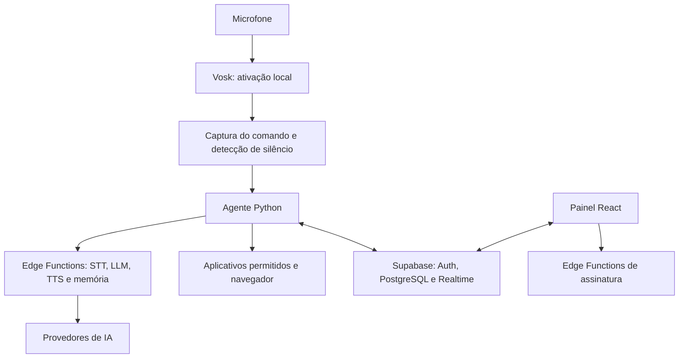

# Nexus

Assistente pessoal que conecta um painel web de produtividade a um agente local de voz e automação no Windows.

O projeto reúne interface em React e TypeScript, agente em Python e serviços de autenticação, persistência e IA por meio de Supabase e Edge Functions.

## Visão geral

O painel organiza tarefas, compromissos, ideias, hábitos, diário, finanças e memória pessoal. O agente recebe comandos por voz ou mensagens do painel, consulta os dados do usuário e executa as ferramentas disponíveis.

| Camada | Implementação |
| --- | --- |
| Interface | React 18, TypeScript, Vite e Tailwind CSS |
| Agente local | Python, Vosk, Silero VAD e sounddevice |
| Dados e autenticação | PostgreSQL, Supabase Auth e Realtime |
| Integrações | Edge Functions para transcrição, LLM, síntese de voz e memória |
| Assinaturas | Funções de integração com Stripe e controle de acesso por plano |

## Recursos presentes no código

- Painel com Kanban, agenda, ideias, hábitos, diário e finanças.
- Chat com histórico de sessões e comunicação com o agente.
- Pareamento do agente por código gerado no painel.
- Detecção local da palavra de ativação e gravação do comando com detecção de silêncio.
- Ferramentas para abrir aplicativos permitidos, URLs e rotinas cadastradas.
- Criação e consulta de tarefas, eventos, hábitos, transações e memórias.
- Proxies autenticados para chamadas de IA, sem exigir chaves dos provedores no agente.

Esses recursos descrevem a implementação disponível. O funcionamento integrado depende da configuração dos serviços, da conta e do plano; uma compilação do frontend não valida os fluxos de voz, pagamentos ou permissões.

## Arquitetura



O frontend e o agente são componentes diferentes: abrir o painel não inicia o processo Python. A detecção da palavra de ativação é local; o processamento posterior utiliza serviços externos.

## Estrutura

```text
agent/                  Agente, voz, ferramentas e comunicação com o backend
frontend/               Aplicação React e configuração do frontend
supabase/functions/     Proxies de IA e funções de assinatura
supabase/migrations/    Evolução do banco e políticas de acesso
setup.bat               Instalador do agente para Windows
requirements.txt        Dependências Python
```

O repositório [nexus-agent](https://github.com/SquintData/nexus-agent) distribui uma versão separada do agente. Ele não deve ser presumido idêntico ao diretório `agent/` deste repositório.

## Desenvolvimento

Requisitos: Node.js 20+, Python 3.11 ou 3.12 e Windows com microfone e saída de áudio para o agente.

### Frontend

Na raiz do repositório:

```powershell
cd frontend
npm ci
Copy-Item .env.example .env
npm run dev
```

Preencha as variáveis do arquivo `frontend/.env` para o backend desejado. A interface de desenvolvimento usa a porta padrão do Vite, `http://localhost:5173`.

### Agente

Em outro terminal, na raiz do repositório:

```powershell
python -m venv .venv
.\.venv\Scripts\python.exe -m pip install -r requirements.txt
.\.venv\Scripts\python.exe -m agent.setup_models
.\.venv\Scripts\python.exe -m agent.main
```

O agente solicita o código de pareamento quando necessário. O painel expõe essa função em `/app/agente`, sujeita ao acesso do plano. As chaves de OpenAI e Groq pertencem aos serviços do backend.

Consulte [Desenvolvimento](docs/development.md) para configuração de um backend próprio e [Implantação](DEPLOYMENT.md) para os componentes necessários.

## Verificações disponíveis

```powershell
cd frontend
npm ci
npm run lint
npm run build
```

O script `lint` executa a checagem TypeScript. O workflow [Frontend CI](.github/workflows/frontend-ci.yml) configura checagem de tipos e build; seu gatilho de push está limitado a `main`, enquanto a branch padrão atual é `master`. Pull requests também estão configurados como gatilho.

Não há suíte automatizada de testes do agente no snapshot atual. Voz, pareamento, atualização em tempo real e cobrança precisam de validação integrada separada.

## Configuração e limites

- O agente contém valores padrão do backend Nexus. Use `SUPABASE_URL` e `SUPABASE_ANON_KEY` para apontar para outro ambiente.
- Tokens de pareamento e sessão são gravados no `.env` local. Não os inclua em commits.
- Variáveis `VITE_*` são públicas no bundle; chaves privilegiadas e de provedores ficam no servidor.
- Migrações de políticas de acesso estão versionadas; sua existência não substitui a validação do ambiente implantado.
- Não há instalador executável ou garantia de funcionamento offline integral documentados neste repositório.
